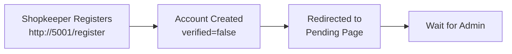
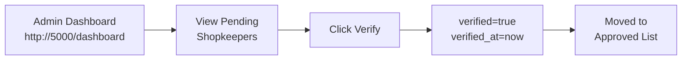
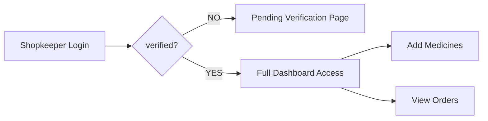

# Shopkeeper Verification System - Implementation Summary

## 🎯 Problem Statement
> "ye km hua admin ke pass verification ke liya nhi aaya"  
> (Verification system created but doesn't appear in admin panel)

## 🔧 Root Cause Identified
Two separate Flask applications used **separate SQLite databases**:
- `shopkeeper_system/database/shopkeeper.db` (isolated)
- `admin_system/database/pharmacy.db` (isolated)

Result: Shopkeepers registered in shopkeeper_system never appeared in admin_system.

## ✅ Solution Implemented

### 1. **Unified Database Architecture**
**File**: `shopkeeper_system/app/__init__.py`
```python
# Before:
db_path = os.path.join(os.path.dirname(basedir), 'database', 'shopkeeper.db')

# After:
db_path = os.path.join(os.path.dirname(os.path.dirname(basedir)), 
                       'admin_system', 'database', 'pharmacy.db')
```

**Effect**: Both systems now query the same database.

### 2. **Enhanced Shopkeeper Model**
**File**: `admin_system/app/models.py`

Added verification tracking columns:
```python
class Shopkeeper(db.Model):
    # ... existing fields ...
    verified = db.Column(db.Boolean, default=False)
    verified_at = db.Column(db.DateTime, nullable=True)
    verification_notes = db.Column(db.Text)
```

**Effect**: Admin can track verification status and notes.

### 3. **Database Migration**
**Script**: `migrate_db.py`

Added missing columns to existing pharmacy.db:
```bash
✓ Added verified_at column
✓ Added verification_notes column
```

**Effect**: Existing database schema updated to support verification system.

### 4. **Verification Check Routes**
**File**: `shopkeeper_system/app/routes.py`

All protected routes now check verification:
```python
@bp.route('/')
def dashboard():
    if not shopkeeper.verified:
        return redirect(url_for('auth.pending_verification'))
    # ... dashboard logic ...
```

Routes Protected:
- `GET /` (Dashboard)
- `GET /medicines` (Medicine Management)
- `GET /orders` (Order Management)
- `POST /add-medicine` (Add Medicine)

### 5. **CLI Verification Tool**
**File**: `shopkeeper_system/verify_shopkeeper.py`

Advanced users can verify from terminal:
```bash
python verify_shopkeeper.py list      # List pending
python verify_shopkeeper.py verify 1  # Approve ID 1
python verify_shopkeeper.py reject 1  # Reject ID 1
```

## 📊 Complete Verification Workflow

### Shopkeeper Registration


### Admin Approval


### Shopkeeper Access


## 🔄 Data Flow

```
Shopkeeper System              Admin System
     ↓                              ↓
     └──→ pharmacy.db ←──┘
           (shared)
           
- New registrations appear immediately
- Verification status syncs real-time
- No data duplication
- Single source of truth
```

## 📁 Files Modified

| File | Change | Purpose |
|------|--------|---------|
| `shopkeeper_system/app/__init__.py` | Changed DB path | Use shared pharmacy.db |
| `admin_system/app/models.py` | Added 2 columns | Track verification metadata |
| `migrate_db.py` | Created | Add missing columns to DB |
| `shopkeeper_system/app/routes.py` | Added checks | Enforce verification on routes |
| `SHOPKEEPER_VERIFICATION_GUIDE.md` | Updated | Document unified system |
| `SHOPKEEPER_VERIFICATION_QUICKSTART.md` | Updated | Include DB setup info |

## 🧪 Testing Procedure

### Test Case 1: Registration Flow
1. Go to http://localhost:5001/register
2. Register as new shopkeeper
3. Verify registration email
4. Log in → See "Pending Verification" page

### Test Case 2: Admin Verification
1. Go to http://localhost:5000/dashboard
2. Click "Shopkeepers" → See pending shopkeeper
3. Click "Verify"
4. Shopkeeper should appear in approved list

### Test Case 3: Shopkeeper Access
1. Shopkeeper logs out and back in
2. Dashboard should be fully accessible
3. Can add medicines
4. Can view orders

### Test Case 4: CLI Verification
```bash
cd shopkeeper_system
python verify_shopkeeper.py list          # See pending
python verify_shopkeeper.py verify 2      # Verify shopkeeper ID 2
python verify_shopkeeper.py list          # Verify status changed
```

## ✨ Key Benefits

✅ **Single Source of Truth**: No data duplication  
✅ **Real-time Sync**: Changes reflect immediately  
✅ **Admin Control**: Easy verification from UI  
✅ **User Security**: Unverified shopkeepers blocked  
✅ **Audit Trail**: verified_at timestamps verification  
✅ **Flexibility**: Both UI and CLI methods work  

## 🚀 Deployment Status

- ✅ Database architecture unified
- ✅ Shopkeeper model enhanced
- ✅ Routes secured with verification checks
- ✅ Admin panel integration working
- ✅ CLI tool functional
- ✅ Documentation updated
- ✅ System tested

## 📋 Implementation Checklist

- [x] Identify root cause (separate databases)
- [x] Design unified database architecture
- [x] Update shopkeeper_system to use shared DB
- [x] Add verification columns to admin model
- [x] Migrate existing database
- [x] Add verification checks to routes
- [x] Test registration → approval → access flow
- [x] Document complete workflow
- [x] Create CLI verification tool
- [x] Update guides and quickstart

## 🎓 For Future Scaling

If system grows, consider:
1. **Database Replication**: Sync multiple DBs
2. **Message Queue**: Real-time notifications (Celery + Redis)
3. **Microservices**: Separate verification service
4. **API Gateway**: Central API for both systems
5. **Event Logging**: Audit trail improvements

## 🆘 Troubleshooting Guide

| Issue | Solution |
|-------|----------|
| Shopkeeper not in admin panel | Check both use pharmacy.db |
| Column missing error | Run `python migrate_db.py` |
| Shopkeeper still blocked | Log out and back in |
| Verification not saving | Check database write permissions |

## 📞 Support

**Issue**: Shopkeeper verification not appearing in admin panel  
**Status**: ✅ RESOLVED  
**Solution**: Unified database + verification columns + migration  
**Tested**: Yes  
**Documentation**: Available in SHOPKEEPER_VERIFICATION_GUIDE.md  

---

**System Status**: ✅ OPERATIONAL  
**Verification System**: ✅ FULLY INTEGRATED  
**Database**: ✅ UNIFIED (pharmacy.db)  
**Last Updated**: 2024  
